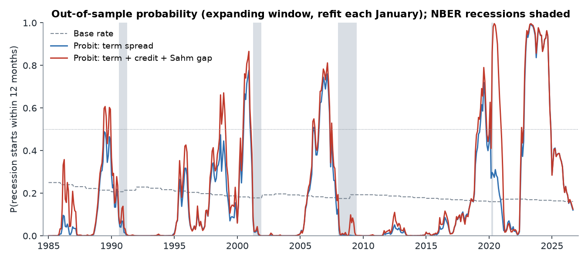
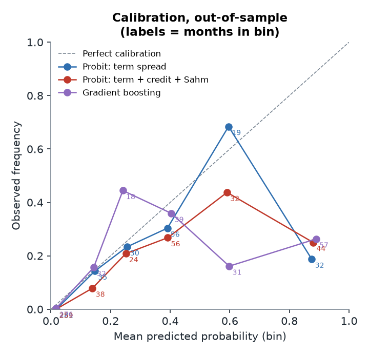
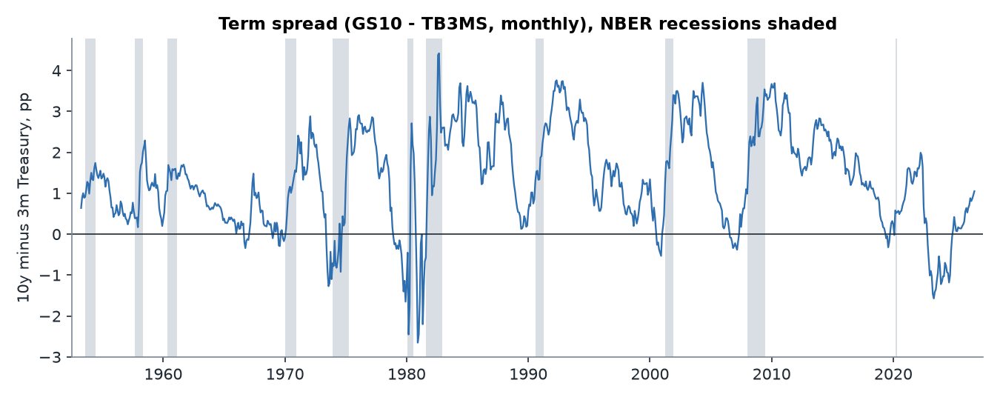

# Recession probability from the yield curve: an honest out-of-sample test

**Question:** what is the probability that a US recession starts within the next 12 months, given the 10-year minus 3-month Treasury spread, the Baa credit spread and a Sahm-rule-style unemployment signal?

**Headline:** in a pseudo-out-of-sample test (1985-2025, refit every January), a one-variable term-spread probit ranks months well (AUC 0.874) and rose above 50% ahead of the 2001, 2008 and 2020 recessions (the last by luck). On Brier score it does **not** beat a simple base rate over the full period (skill score -0.014), because it put a 99.2% probability on a recession during the 2022-24 inversion and none has been dated. Scored on 1985-2021 only, the same forecasts have a skill score of 0.453. Adding credit and labour signals did not help out of sample. As of September 2026 the term-spread probit gives **11.8%**, below the 15.9% historical base rate.



---

## Data

Five monthly series from FRED, downloaded through the public CSV endpoint (no API key) and cached in [`data/`](data/) so the results reproduce exactly. `python run.py --refresh` downloads them again.

| Signal | Construction | FRED series | Starts |
|---|---|---|---|
| Term spread | 10-year Treasury yield minus 3-month T-bill, monthly averages | `GS10` - `TB3MS` | 1953-04 |
| Credit spread | Moody's Baa corporate yield minus 10-year Treasury | `BAA` - `GS10` | 1953-04 |
| Labour signal ("Sahm gap") | 3-month average unemployment rate minus its minimum over the previous 12 months | `UNRATE` | 1948 |
| Outcome | NBER recession indicator, 1 in recession months | `USREC` | 1854 |

I use `GS10 - TB3MS` rather than FRED's daily `T10Y3M` because it extends the history back to 1953. That gives the models six recession starts (1957, 1960, 1970, 1973, 1980, 1981) to learn from before the 1985 test window opens; `T10Y3M` only begins in 1982. Over their 1982-2026 overlap the two have a correlation of 0.9956 and differ by 0.116 pp on average (`TB3MS` is quoted on a discount basis). `BAA - GS10` matches FRED's `BAA10Y` with correlation 1.0. These checks are in [`results/data_checks.json`](results/data_checks.json).

The October 2025 unemployment rate was never published (federal government shutdown). I carry September's value forward, which uses only past data.

## Method

**Target.** For month *t*, `y_t = 1` if `USREC = 1` in any of the months *t+1 ... t+12*, and 0 otherwise. Models are trained and scored only on expansion months (`USREC_t = 0`), so `y_t = 1` means exactly *"a recession starts within the next 12 months"*. Months already in recession are dropped: predicting that a recession under way will continue is not a useful forecast. The month's own `USREC` value is never part of its label, and the label is undefined (not zero) until all 12 future months are observed. See [`recession/target.py`](recession/target.py).

**Models.**
1. **Base rate:** the share of training months followed by a recession. This is the benchmark every model has to beat.
2. **Term-spread probit** (Estrella-Mishkin style): `P(y=1) = Φ(a + b·spread)`. This is the champion because it is interpretable.
3. **Three-signal probit:** term spread + credit spread + Sahm gap.
4. **Gradient boosting** on the same three signals, as a non-linear challenger (shallow trees, 150 rounds).

**Pseudo-out-of-sample evaluation.** Each January from 1985 to 2026 every model is refit on an expanding window that starts in mid-1954 (the first month with all three signals). It then predicts the 12 months of that year. A training month *t* is allowed only if its whole outcome window *t+1 ... t+12* ends before the refit date, and labels are rebuilt from `USREC` cut at that date. The forecaster therefore never sees a recession it could not have known about. Unit tests check this directly: changing every `USREC` value after a refit date leaves that year's forecasts unchanged ([`tests/`](tests/)). There are 453 scored expansion months in total, 48 of them followed by a recession within a year.

**Metrics.** Brier score, and Brier skill score against the expanding base rate (above 0 means the model beats the benchmark). Also AUC, log loss, a calibration table, and hit and false-alarm rates at a 50% threshold. Neighbouring months share most of their 12-month outcome window, so the effective sample is closer to "four recessions" than to "453 months". The skill score's 90% interval therefore comes from a moving-block bootstrap with 24-month blocks.

## Results

Out of sample, expansion months 1985-01 to 2025-09 ([`results/metrics.csv`](results/metrics.csv)):

| Model | Brier | Skill vs base rate | 90% CI (block bootstrap) | AUC | Log loss | Hit rate @50% | False-alarm rate @50% |
|---|---|---|---|---|---|---|---|
| Base rate | 0.105 | 0.000 | - | - | 0.374 | 0.000 | 0.000 |
| **Probit: term spread** | **0.106** | **-0.014** | [-0.78, 0.50] | **0.874** | **0.346** | 0.396 | 0.079 |
| Probit: term + credit + Sahm gap | 0.122 | -0.165 | [-0.99, 0.40] | 0.859 | 0.410 | 0.521 | 0.126 |
| Gradient boosting | 0.144 | -0.369 | [-1.21, 0.33] | 0.830 | 0.465 | 0.417 | 0.168 |

The same forecasts scored on 1985-2021 only (no refit; [`results/metrics_scored_1985_2021.csv`](results/metrics_scored_1985_2021.csv)) show how much of the full-period result comes from one episode:

| Model | Brier | Skill vs base rate | AUC |
|---|---|---|---|
| Base rate | 0.113 | 0.000 | - |
| **Probit: term spread** | **0.062** | **0.453** | **0.941** |
| Probit: term + credit + Sahm gap | 0.078 | 0.310 | 0.921 |
| Gradient boosting | 0.087 | 0.236 | 0.903 |

**Before each recession.** The table shows the average and maximum out-of-sample probability over the months 12 to 6 before each NBER start ([`results/recession_table.csv`](results/recession_table.csv)):

| Recession start | Base rate | Term-spread probit: mean / max | Three-signal probit: mean / max | Lowest term spread in window (pp) |
|---|---|---|---|---|
| 1990-08 | 0.212 | 0.371 / 0.465 | 0.475 / 0.603 | 0.180 |
| 2001-04 | 0.183 | 0.501 / 0.714 | 0.583 / 0.808 | -0.370 |
| 2008-01 | 0.179 | 0.604 / 0.760 | 0.645 / 0.812 | -0.380 |
| 2020-03 | 0.163 | 0.584 / 0.720 | 0.653 / 0.790 | -0.320 |

The spread probit was above the base rate ahead of all four recessions. It crossed 50% before 2001, 2008 and 2020 but not 1990, when the curve flattened without inverting. The 2020 result is luck, not skill: the curve inverted in 2019, but the recession came from a pandemic that no bond-market signal predicted.

**Interpretation of the champion.** Fit on the full labelled sample (1954-2025, [`results/probit_coefficients_full_sample.csv`](results/probit_coefficients_full_sample.csv)), the term-spread coefficient is -0.836 (z = -10.90). At the sample mean, each 1 pp lower spread raises the 12-month recession probability by about 11.68 percentage points (marginal effect -0.1168). In the three-signal probit, neither the credit spread (p = 0.8533) nor the Sahm gap (p = 0.3745) adds anything once the term spread is included.



**Calibration.** Up to about 50% the term-spread probit is roughly calibrated: in the 10-20% bin the observed frequency was 0.1429, and in the 20-30% bin it was 0.2333. The top bin (mean forecast 0.8750, 32 months) had an observed frequency of only 0.1875. Most of those months are the 2022-24 inversion ([`results/calibration.csv`](results/calibration.csv)).

## False alarms and what they mean

[`results/signal_episodes.csv`](results/signal_episodes.csv) lists every run of months with probability ≥ 50%. For the term-spread probit there are four hits (2000-07, 2006-07, 2019-05, 2020-02) and two false alarms. The first is a single month (2006-02). The second is the big one:

- **2022-11 to 2024-11: 25 consecutive months above 50%, peaking at 99.2% in 2023-05**, when the spread reached -1.57 pp. No NBER recession has been dated in the `USREC` data through 2026-09, so every one of those months is scored as a miss ([`results/inversion_2022_2024.json`](results/inversion_2022_2024.json)).

This one episode accounts for nearly all of the gap between the 0.453 skill score on 1985-2021 and the -0.014 on the full sample. The model's mistake was not the direction of the signal. It was extreme confidence: probit tails get very thin when the spread is far outside the range seen in most of the training data. Plausible reasons the inversion did not work this time include:

- **Term premium.** The 10-year term premium was unusually low or negative, so the inversion said less about expected rate cuts than it used to.
- **Policy rate rather than expectations.** The 3-month rate was pushed up by a very fast hiking cycle, not by markets expecting a downturn.
- **Strong balance sheets.** Households and firms had locked in low fixed rates, which delayed the pass-through of higher rates.

These are explanations, not things this repo tests. The practical lesson for anyone using the signal is to treat probabilities above about 50% as "the yield curve is flashing", not as literal odds.

The richer models did worse, mostly for a mechanical reason. The Sahm gap and the credit spread stay high for months *after* a recession ends. As a result the three-signal probit put a probability of 0.996 on a new recession during the 2020 recovery (2020-05 to 2020-12), and boosting also raised a series of false alarms in the 1990s. With only four test-period recessions, extra flexibility mostly fits noise.

## Current reading

As of **2026-09**, the latest month with all inputs ([`results/current_reading.json`](results/current_reading.json)):

| | Value |
|---|---|
| Term spread (GS10 - TB3MS) | 1.05 pp |
| Credit spread (Baa - 10y) | 1.48 pp |
| Sahm gap | 0.00 pp |
| **Term-spread probit (fit on 1954-2025)** | **11.8%** (90% band from parameter uncertainty: 9.5%-14.4%) |
| Three-signal probit | 12.2% (9.7%-15.2%) |
| Historical base rate (expansion months) | 15.9% |

The probability has fallen steadily over the past year, from 0.3051 in 2025-10 to 0.1176 in 2026-09 ([`results/recent_12m_full_sample_fit.csv`](results/recent_12m_full_sample_fit.csv)), as the curve re-steepened. The daily `T10Y3M` was 0.77 pp on 2026-10-27, flatter than September's monthly average. The parameter band understates the real uncertainty: it ignores model uncertainty, and the same model was confidently wrong in 2023. The honest summary is that the yield curve currently gives no recession warning, and its absence of a warning has historically been more reliable than its warnings.

## Limitations

- **Look-ahead in the outcome.** NBER announces turning points with lags of several months to nearly two years, and `USREC` is the final, revised series. The main backtest assumes each month's `USREC` value is known the following month, so a 12-month outcome is known 12 months later. A robustness run delays all `USREC` information by a further 12 months, and changes little: term-spread probit skill -0.032, AUC 0.870 ([`results/metrics_label_lag12.csv`](results/metrics_label_lag12.csv)).
- **No real-time data vintages.** Yields are not revised, but unemployment is, through seasonal-factor revisions. I use today's FRED values, not ALFRED vintages, so the Sahm gap is slightly cleaner than a forecaster would have seen at the time.
- **The 2022-24 verdict is provisional.** It is a false alarm under the data available through 2026-09. If NBER later dates a peak in late 2025 or 2026, some of those months become hits.
- **Small sample.** There are four recessions in the test period, one of them a pandemic. The skill-score confidence intervals span zero for every model, so I do not claim that any model beats the base rate on Brier score with statistical confidence.
- **Structural change.** Term premia, central-bank balance sheets and forward guidance have changed what the spread measures since the 1950s-80s training data.
- **Not tested.** NFCI was left out because the index is re-estimated on the full sample each week, which would bring look-ahead in through the back door. Other common additions such as the near-term forward spread, equity returns and housing were not tried.

## How to run

```bash
python3 -m venv .venv && .venv/bin/pip install -r requirements.txt
.venv/bin/python run.py        # all results, tables and figures (about 5 seconds, from cached data)
.venv/bin/python -m pytest     # 14 tests: target construction, no leakage, expanding-window splitter
# or simply: make
```

Tested with Python 3.14. `run.py` writes everything to `results/` (CSV/JSON plus a generated [`results/summary.md`](results/summary.md)) and `figures/`.

```
recession/          data.py (FRED download + features), target.py, splits.py,
                    models.py, backtest.py, evaluate.py, plots.py
tests/              test_target.py, test_splits.py
data/               cached FRED CSVs
results/, figures/  generated by run.py
```



---

Every number here is produced by the code in this repo.
